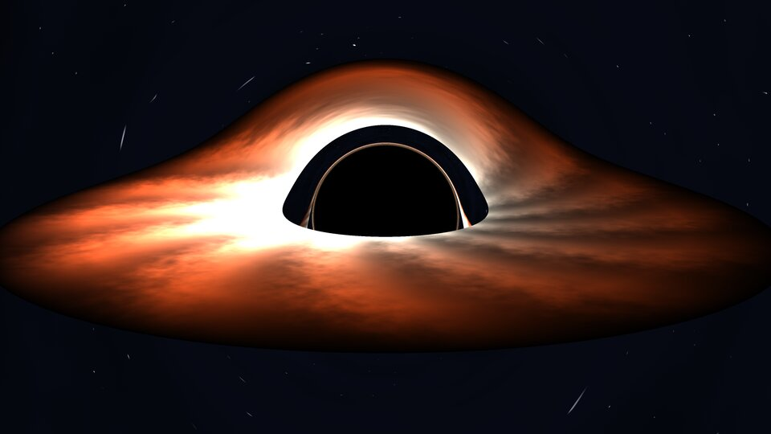

# Black hole



`blackhole.comp` is the Vulkan compute port of `examples/blackhole.mgf`:
Schwarzschild null geodesics, a thin accretion disk, Doppler beaming,
gravitational redshift and the photon ring. `time` rotates the disk
pattern with a Keplerian-like angular speed.

## Scripts

```sh
./run_still.sh      # 1920x1080, 2x SSAA -> out/blackhole_vk.png
./run_video.sh      # 125 frames, 1920x1080, H.264 -> out/blackhole_vk.mp4
./run_dof.sh        # 64 samples, aperture 0.4, focus 24 -> out/blackhole_dof.png
./run_dof_video.sh  # 8 samples, 125 frames -> out/blackhole_dof.mp4
```

From the repo root: `make blackhole-vk`, `make blackhole-vk-video`,
`make blackhole-dof`, `make blackhole-dof-video`.

DoF is subtle here because the scene is astrophysical: the black hole and
disk are far away. The aperture/focus parameters are cinematic camera
settings, not a real telescope. For an obvious DoF example see
`examples/vulkan/dof_demo`.
